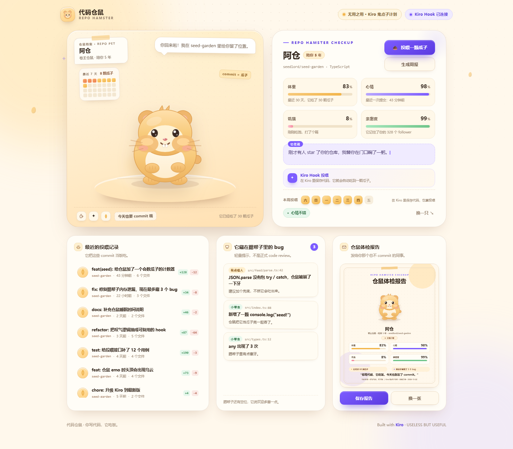
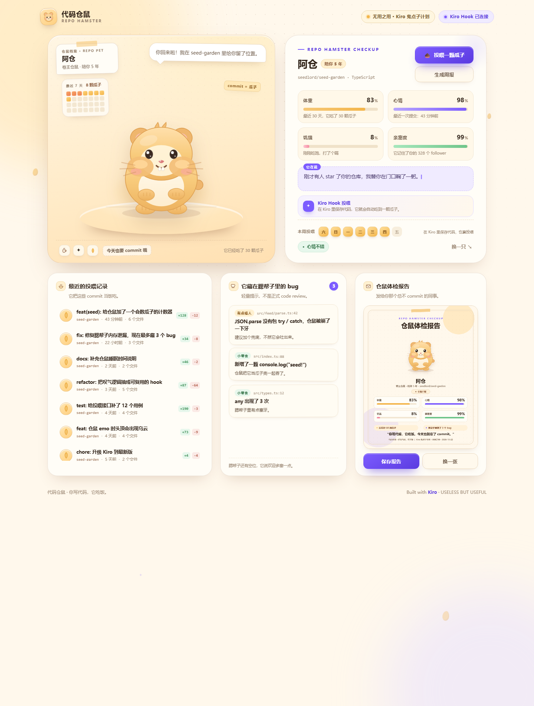
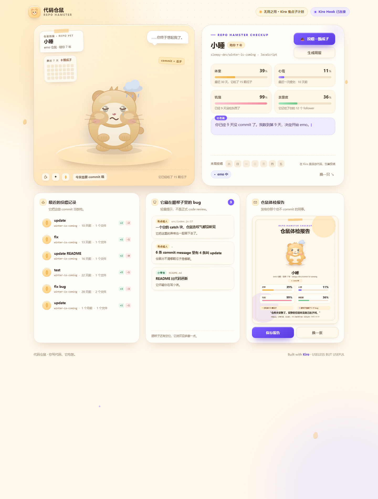
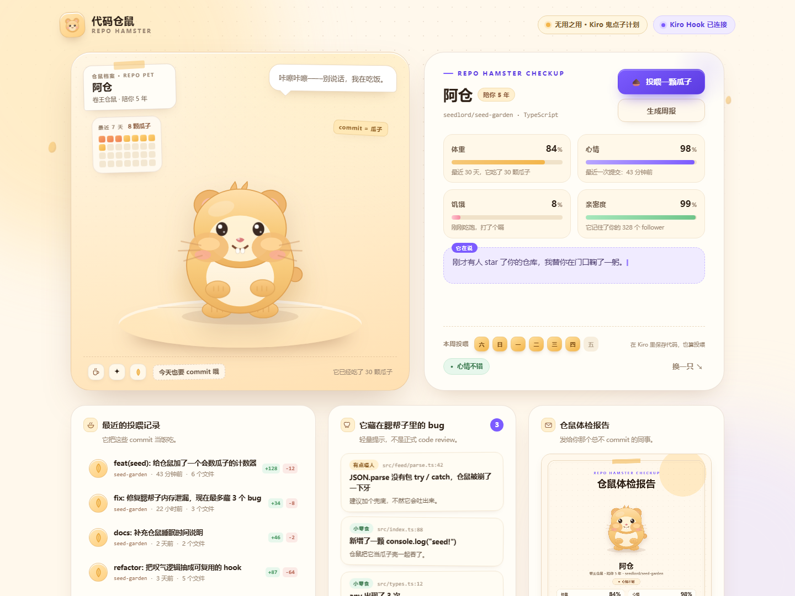
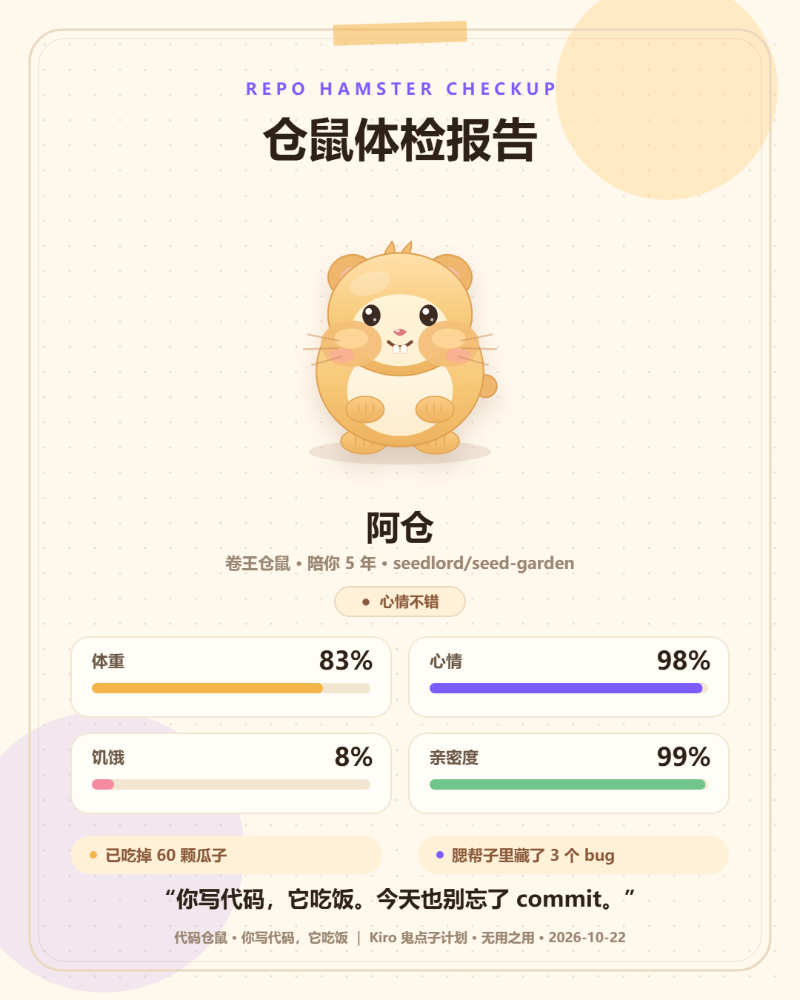

# 🐹 代码仓鼠 · Repo Hamster

> **你写代码，它吃饭。**  
> Kiro 鬼点子计划 · 无用之用 / USELESS BUT USEFUL

**[立即在线试玩](https://hahaaa520.github.io/kiro-repo-hamster/)** · [演示档案直达](https://hahaaa520.github.io/kiro-repo-hamster/app/index.html?demo=champion&noloading=1) · [本地运行](#快速开始) · [English](#english)



**代码仓鼠**是一个住在 GitHub 仓库里的电子宠物：输入用户名即可领养；提交频率、commit message 与最新 diff 会变成它的体重、心情、饥饿和亲密度。7 天不提交它会 emo，14 天它会离家出走；它还会根据最新 diff 给出轻量提示，并生成一张可分享的「仓鼠体检报告」。

## English

Repo Hamster is a virtual pet powered by public GitHub activity. Commits feed it, commit messages and recent diffs shape its mood, and inactivity makes it emo—or run away. The static demo includes built-in profiles, playful code hints, and a shareable health report. No login or GitHub authorization is required for the online demo.

## ✨ 它能做什么

| 功能 | 说明 |
|---|---|
| 🐹 快速领养 | 输入 GitHub 用户名，只读公开仓库；不用登录、不用授权 |
| 📊 四个状态 | 体重 / 心情 / 饥饿 / 亲密度，由提交频率、message、diff 计算 |
| 🌰 投喂瓜子 | 咀嚼动画 + 瓜子粒子，并实时更新仓鼠状态 |
| 🌧️ emo 与出走 | 7 天不提交进入 emo；14 天出现空笼子、爪印与留言 |
| 🦷 腮帮子 bug | 根据最新 diff 输出至多 3 条轻量启发式提示 |
| 📮 体检报告 | Canvas 生成 1080×1350 分享卡，可保存或发布 |
| 🪝 Kiro Hook | 在 Kiro 里保存代码 → 自动跑测试 → 投喂仓鼠（SSE 实时联动） |
| 📴 断网可演 | 内置卷王 / 摆烂 / 普通三只演示仓鼠，无网络也能完整演示 |

## 🚀 快速开始

### 方式 A：免安装（推荐，不需要 Node）

1. 下载或克隆本仓库，保持 `app/` 目录结构。
2. 双击 `app/打开演示.bat`。
3. 或直接打开 `app/index.html`。

演示档案：`app/index.html?demo=champion&noloading=1`，可将 `champion` 换成 `lazy` 或 `normal`。

### 方式 B：本地服务（含 Kiro Hook）

```bash
cd app
node server.mjs
# 打开 http://localhost:5173
```

- 演示档案：`http://localhost:5173/?demo=champion&noloading=1`
- 手动投喂：`curl -X POST http://localhost:5173/feed`
- Kiro Hook 模板：`app/.kiro/hooks/feed-hamster.kiro.hook`

> 在线版是纯静态 Demo，内置演示档案与分享卡；Kiro Hook 联动需要本地运行 `node app/server.mjs`。

## 🖼️ 更多截图

| 卷王仓鼠 | 摆烂仓鼠（emo） |
|---|---|
|  |  |

| 投喂状态 | 体检报告 |
|---|---|
|  |  |

## 🧠 用 Kiro 开发

整个项目使用 **Kiro** 开发，工程配置位于 `app/.kiro/` 与 `kiro/`：

- **Quick Spec**：一句话拆成 `requirements.md` / `design.md` / `tasks.md`
- **并行 tasks**：按依赖关系拆分任务
- **Crew 子 Agent**：仓鼠人格、commit 考古和界面分工
- **Agent Hooks**：保存代码 → 跑测试 → `POST /feed` → 仓鼠进食
- **多模型协作**：不同模型负责人格文案、代码审查和任务调度

> 一句话：**Kiro Hook 就是它的消化系统。**

Spec 三件套：

- [`app/.kiro/specs/repo-hamster/requirements.md`](app/.kiro/specs/repo-hamster/requirements.md)
- [`app/.kiro/specs/repo-hamster/design.md`](app/.kiro/specs/repo-hamster/design.md)
- [`app/.kiro/specs/repo-hamster/tasks.md`](app/.kiro/specs/repo-hamster/tasks.md)

Hook 模板：

- [`app/.kiro/hooks/feed-hamster.kiro.hook`](app/.kiro/hooks/feed-hamster.kiro.hook)
- [`app/.kiro/hooks/weekly-report.kiro.hook`](app/.kiro/hooks/weekly-report.kiro.hook)

## 📦 路演与交付物

| 内容 | 文件 |
|---|---|
| 单文件路演页（动画版） | [`deliver/代码仓鼠-路演.html`](deliver/代码仓鼠-路演.html) |
| 路演 PPT（8 页，含演讲备注） | [`deliver/代码仓鼠-路演.pptx`](deliver/代码仓鼠-路演.pptx) |
| Demo 成果说明 PDF（10 页） | [`deliver/代码仓鼠-Demo成果说明.pdf`](deliver/代码仓鼠-Demo成果说明.pdf) |
| 路演逐字稿（5 分钟＋30 秒＋Q&A） | [`deliver/路演逐字稿.md`](deliver/路演逐字稿.md) |
| 8 页 Deck 总览 | [`deck/shots/contact-sheet.png`](deck/shots/contact-sheet.png) |

## 🗂️ 目录结构

```text
.
├─ app/                        产品本体（原生 HTML/CSS/JS，无构建、无 npm 依赖）
│  ├─ index.html
│  ├─ css/style.css
│  ├─ js/hamster.js            手写 SVG 仓鼠与状态动画
│  ├─ js/engine.js             状态公式、文案与演示档案
│  ├─ js/app.js                交互、GitHub 数据、分享卡与 SSE
│  ├─ server.mjs               静态服务、/feed 与 /events
│  └─ .kiro/                   Spec、Hooks 与 Steering
├─ deck/                       路演源文件、构建脚本与截图
├─ deliver/                    HTML、PPTX、PDF 与逐字稿
├─ kiro/                       Kiro 工程包与现场方案
└─ serve-root.mjs              Deck 本地预览
```

## ⚙️ 技术实现

- **纯前端**：原生 HTML、CSS、JavaScript，无框架、无构建步骤、无 npm 依赖。
- **手写 SVG 仓鼠**：happy、hungry、emo、eating 四种状态与呼吸、眨眼、咀嚼、眼泪动画。
- **GitHub 数据**：只读公开 REST API，失败时回退到演示档案。
- **状态机**：提交频率、commit message 和最近 diff 驱动宠物状态。
- **轻量提示**：基于 diff 的启发式规则，不等同于完整静态分析或人工代码审查。
- **分享卡**：Canvas 2D 生成 1080×1350 PNG。
- **本地联动**：零依赖 Node 服务提供 `POST /feed` 和 SSE `GET /events`。

## 🎯 活动背景

- 活动：Kiro「鬼点子」计划 · 你的奇思妙想，Kiro 来实现
- 赛道：**无用之用**（USELESS BUT USEFUL）
- 形式：线下 150 分钟极限开发＋路演评审
- 时间：2026.10

## 📌 数据与边界

- 只读公开 GitHub 数据，不登录、不写数据库、不在前端存密钥。
- GitHub API 可用性与频率限制会影响实时数据加载，演示档案可作为回退。
- 这是一个「没什么用」的创意项目：**它没什么用，但你会因为它，想多写一行好代码。**

## 📄 License

本项目采用 [MIT License](LICENSE)。第三方服务、字体、图标或素材如另有许可，仍遵循各自条款。

---

<p align="center"><b>代码仓鼠 · 你写代码，它吃饭。</b></p>
